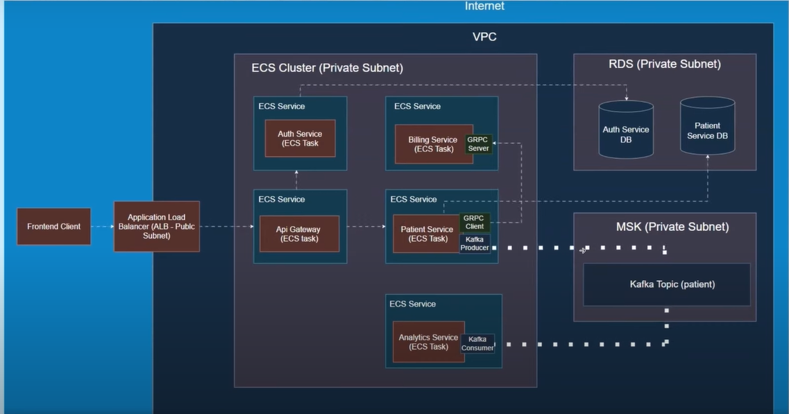

# Patient Management Backend System

I built this backend to create a scalable and resilient system for managing patient data and hospital operations, replacing monolithic designs with a microservices approach. It handles patient records, billing, and analytics while ensuring secure inter-service communication, event-driven updates, and end-to-end integration testing. The system is implemented using Java Spring Boot with gRPC for service calls, Kafka for event streaming, JWT for authentication, Docker for containerization, and AWS for cloud deployment.

